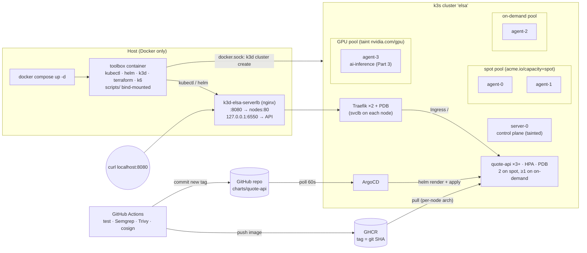
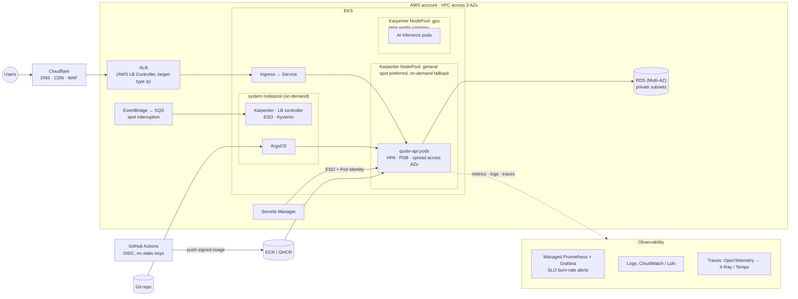

# quote-api on a local multi-nodepool Kubernetes cluster

ELSA DevOps take-home. A small Python service runs on a k3d cluster that simulates spot / on-demand / GPU nodepools. It is deployed by ArgoCD from this repo and survives a spot reclaim. CI builds, scans, signs and releases it through GitHub Actions.

**Image:** `ghcr.io/triethuynh1408/quote-api:<git-sha>` (linux/amd64 + linux/arm64, cosign-signed). The deployed tag is in [`charts/quote-api/values.yaml`](charts/quote-api/values.yaml).

## Quick start

Requires only Docker. Nothing else is needed on the host.

```bash
git clone https://github.com/triethuynh1408/elsa-devops-test.git && cd elsa-devops-test
docker compose up -d        # toolbox + k3d cluster (1 server + 4 agents), nodepools labelled
./scripts/run-all.sh        # every numbered task script, in order
curl http://localhost:8080/api/quote
```

- **Timing.** The first `up` takes a few minutes: a one-time toolbox image build plus image pulls. Cluster bootstrap is ~1–2 min. `run-all.sh` can start immediately: it waits for the bootstrap to finish.
- **What it runs:** cluster status → ArgoCD + app deploy → spot-reclaim drill → Part 3 fixes (`verify.sh` prints `PASS`) → Part 5 validation (Terraform and Karpenter).
- **Teardown:** `./scripts/99-teardown.sh && docker compose down`

## Architecture



**Request path:** `localhost:8080` → k3d load balancer → Traefik (2 replicas) → Service → quote-api pods.

**Release path:** push to `main` → CI tests, scans, builds and signs the image → CI commits the new tag to `values.yaml` → ArgoCD syncs → rolling update. CI never holds cluster credentials.

## Script reference

All scripts are idempotent. Run from the host, they re-execute themselves inside the toolbox.

| Script | What it does | When |
|---|---|---|
| `00-bootstrap-cluster.sh` | Creates or starts the k3d cluster, wires the toolbox to it, runs `troubleshoot/prepare.sh`, configures Traefik | Automatically on `docker compose up` |
| `10-cluster-status.sh` | Waits for bootstrap; prints nodepool labels and taints | Any time |
| `20-deploy.sh` | Installs ArgoCD, creates the `quote-api` Application, waits for Synced/Healthy, prints placement, curls the ingress | After bootstrap |
| `25-reclaim-drill.sh` | Drains a spot node running the app while curling; shows rescheduling; uncordons; fails on any non-200 | After 20 |
| `30-troubleshoot.sh` | Applies `troubleshoot/fixed-app.yaml` and runs `troubleshoot/verify.sh` (`PASS`) | Any time after bootstrap |
| `50-validate-tf.sh` | Part 5b: `terraform fmt -check`, `init -backend=false`, `validate` for the Cloudflare config | Any time |
| `51-validate-karpenter.sh` | Part 5a: installs the pinned Karpenter CRDs (schemas only) and server-side dry-runs `karpenter/*.yaml` | Any time after bootstrap |
| `run-all.sh` | Runs 10 → 20 → 25 → 30 → 50 → 51 (skips 00 and 99) | Reviewer entry point |
| `99-teardown.sh` | Deletes the k3d cluster (then `docker compose down`) | Cleanup |
| `build-push.sh` | Host-only fallback for building and pushing the image; CI normally does this | Only without CI |

## Repository layout

```
app/                  Flask service, multi-stage Dockerfile, tests
charts/quote-api/     Helm chart (Deployment, Service, Ingress, HPA, PDB) - synced by ArgoCD
argocd/               ArgoCD Application
platform/             ArgoCD values, Traefik overrides
k3d/ toolbox/         cluster definition, toolbox image (pinned + checksum-verified CLIs)
scripts/              numbered task scripts
troubleshoot/         Part 3 (provided files + fixed-app.yaml)
.github/workflows/    CI/CD (Part 4)
karpenter/            Part 5a: GPU NodePools + EC2NodeClass (Karpenter v1)
terraform/cloudflare/ Part 5b: DNS record, import block, cache rules (provider v5)
```

## Design decisions & trade-offs

**Service and image (Part 1)**
- **Python/Flask + gunicorn, 1 worker per container.** It scales by pods (HPA), not processes, and keeps Prometheus counters correct.
- **`/api/quote` burns ~100 ms of CPU *time*** (`thread_time`), so throttling shows up as latency, like a real CPU-bound handler.
- **Image:** multi-stage, numeric non-root UID 10001, read-only root filesystem, multi-arch (built on Apple Silicon, likely run on amd64).
- **Graceful shutdown:** readiness fails on SIGTERM, then gunicorn drains in-flight requests.

**Cluster and GitOps (Part 2)**
- **k3d driven from the toolbox via the Docker socket.** Compose stays one service, and the reviewer needs nothing but Docker. Trade-off: socket access is root-equivalent; fine for a laptop, never for shared CI.
- **Placement**, from soft to hard:
  - preferred affinity for spot;
  - **hard** topology spread on `acme.io/capacity` with `maxSkew: 2`. With 3 replicas this forces 2 spot + 1 on-demand. `maxSkew: 1` would mean 50/50 and lose the spot savings;
  - **soft** spread by hostname. A hard one leaves the evicted pod Pending during a drain, because the cordoned node still counts as an empty domain;
  - `nodeTaintsPolicy: Honor`: if both spot nodes are reclaimed, replicas fall back to on-demand. Verified;
  - `matchLabelKeys: pod-template-hash`: each rollout keeps its own on-demand replica.
- **Zero dropped requests on a drain:** PDB `maxUnavailable: 1`, `preStop` sleep, and readiness probes. For the ingress: **Traefik ×2 + PDB + 10s `requestAcceptGraceTimeout`**. Without that last setting, draining a node that hosted Traefik reset ~10 s of all traffic; that incident is described in `AI-USAGE.md`.
- **The HPA owns the replica count.** The Deployment has no `replicas` field, so ArgoCD doesn't fight the HPA.

**Troubleshooting (Part 3)**
- **Fixed layer by layer on the live cluster**, one failure at a time.
- **`default-deny` is kept.** Three least-privilege policies cover smoke-client DNS, smoke-client → web, and web ← smoke-client. They were also tested negatively.

**CI/CD (Part 4)**
- **Semgrep as a hard gate** (no server, no token). **Trivy** gates HIGH/CRITICAL with a fix available, run *before* the push.
- **Keyless cosign signing** and **actions pinned by commit SHA**. The workflow has `permissions: {}` and holds no long-lived secrets.
- **Deploy = commit the new tag; ArgoCD rolls it out.** This replaces the legacy `kubectl set image` with a kubeconfig in CI. Details: `MIGRATION-NOTES.md`.

**IaC (Part 5)**
- **Every API version was checked against the real thing, not memory.**
  - Karpenter v1.15 manifests are validated by a server-side dry run against that release's CRDs, which enforces the schema and the CEL rules.
  - The Terraform is written against the Cloudflare v5 schema read from the provider.
  - Negative checks confirm that the old forms fail: `v1beta1`, `WhenUnderutilized`, `cloudflare_record`, and `rules { }` blocks.
- **GPU spot first, on-demand fallback, through weighted NodePools with separate spend caps.** The pools use `WhenEmpty` consolidation and a 1-node budget, so a busy inference node is never repacked. See [`karpenter/README.md`](karpenter/README.md) and [`terraform/cloudflare/README.md`](terraform/cloudflare/README.md).

## What I cut, and why

- **Part 6 (load test + Prometheus/Grafana).** I did Parts 4 and 5, which are closest to the platform backlog described in the brief, and preferred doing them well over adding a third track. The groundwork for Part 6 exists: an HPA, `/metrics` with a latency histogram, and k6 in the toolbox.
- **APM tracing (bonus).** Skipped to keep the release stable. The plan is the OpenTelemetry SDK (Flask auto-instrumentation plus a manual span around the CPU work), exported over OTLP to a collector (Jaeger locally, X-Ray/Tempo in production), with parent-based ratio sampling. With gunicorn, the tracer must be initialised per worker (`post_fork`) once preload or several workers are used.
- **ArgoCD app-of-apps / self-management.** With one app, the extra indirection adds moving parts without showing anything new. `20-deploy.sh` installs ArgoCD with `helm upgrade --install`.
- **TLS, ArgoCD SSO, Kyverno signature enforcement.** These are production concerns with no signal on a laptop. The signing side is done, so enforcement is one policy away.
- **Rebalancing after a drain (descheduler), distroless base image, digest pinning.** All three are noted as next steps.

## Known limitations

- **HPA scale-down can remove the on-demand replica:** topology spread is checked when a pod is scheduled, not when one is deleted. Fix: the descheduler, or `pod-deletion-cost`.
- **On a fresh install the Deployment starts with 1 pod for ~15 s**, until the HPA applies `minReplicas`.
- **The base image has unfixed Debian HIGH CVEs.** The gate uses `--ignore-unfixed`; see `MIGRATION-NOTES.md`.
- **The Ingress routes `/`, so `/metrics` and the probe endpoints are reachable from outside.** That's harmless locally. In production, the Ingress would route only `/api` and Prometheus would scrape in-cluster.

## Troubleshooting notes (on the reviewer's machine)

| Problem | Fix |
|---|---|
| **Port 8080 or 6550 already in use** (`docker compose logs toolbox` shows a bind error) | Free the port. For 8080 you can instead run `./scripts/99-teardown.sh; docker compose down; HTTP_PORT=8081 docker compose up -d`. 6550 (the K8s API, bound to 127.0.0.1) is set in `k3d/cluster.yaml` |
| **Pods Pending / OOMKilled, or a slow, flaky drill** | The full stack uses ~3 GiB of RAM. Give Docker ≥ 4 GiB (6 GiB is comfortable) and ≥ 4 CPUs |
| **Apple Silicon vs. x86** | Nothing to do: the app image is multi-arch and the toolbox builds for the host arch. If you see `exec format error`, a single-arch image was pulled. Check with `docker buildx imagetools inspect ghcr.io/triethuynh1408/quote-api:<tag>` |
| **`curl` returns `404 page not found`** | That's Traefik with no Ingress yet: deploy hasn't run or isn't synced. Run `./scripts/20-deploy.sh` |
| **Bootstrap failed** | `docker compose logs toolbox`, then re-run `./scripts/00-bootstrap-cluster.sh` (idempotent) |
| **Using kubectl from the host** | `KUBECONFIG=./kubeconfig kubectl get pods -A`. Use it per command, so your `~/.kube/config` isn't shadowed, or use `docker compose exec toolbox bash` |

## Bonus: the same service in production on AWS



## Other deliverables

- [`TROUBLESHOOTING.md`](TROUBLESHOOTING.md): Part 3, issue by issue, with the commands used
- [`MIGRATION-NOTES.md`](MIGRATION-NOTES.md): Part 4, what changed from GitLab CI and why
- [`karpenter/README.md`](karpenter/README.md), [`terraform/cloudflare/README.md`](terraform/cloudflare/README.md): Part 5, including the spot vs on-demand paragraph
- [`OPS-ANSWERS.md`](OPS-ANSWERS.md): Part 7
- [`AI-USAGE.md`](AI-USAGE.md): how AI was used, verified and corrected
